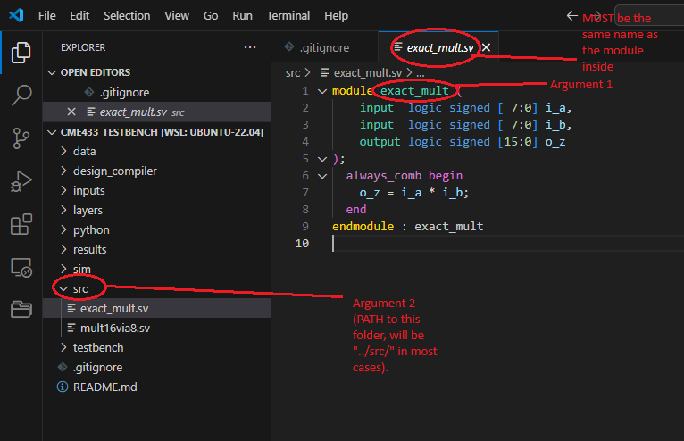

# Literature Review TB for CME 433 and EE 800
This git contains the testbench files for the LR exercise. Please direct any queries to Sayed @ ckp908@usask.ca  

The exercise uses two networks built from 8-bit fully connected layers: a classifier (MNIST digits, 784-256-128-10, 100 test images) and a denoising autoencoder (noisy MNIST digits, 784-256-128-784, 200 test images).

Your multiplier replaces one of the four 8-bit multipliers inside the 16-bit multiplier used by every layer (`src/mult16via8.sv`), the one that handles the low 7 bits of both operands.

> [!IMPORTANT]
> Run everything on a USASK ENGR Lab machine. You need `python3` (3.6 or newer) with `numpy` and `matplotlib`. `./lr` loads QuestaSim and Design Compiler by itself. If you run `design_compiler/run_dc_analysis.csh` by hand, first type `csh` in the terminal (once in every new terminal window).

# Instructions

## 1. Check your setup
```bash
./lr check
```
This simulates the exact multiplier on both models. You should see `Acc all 96.0` for the classifier and `PSNR all 19.17` for the denoiser. The first run takes about a minute, later runs skip this step. `./lr eval` and `./lr synth` take about 3 minutes each.

## 2. Write your multiplier
Put your multiplier in a SystemVerilog file outside `src/` (any name except `exact`), or edit `src/approx_mult.sv` directly. The file must contain exactly one module named `approx_mult` with this interface:
```systemverilog
module approx_mult (
    input  logic signed [ 7:0] i_a,
    input  logic signed [ 7:0] i_b,
    output logic signed [15:0] o_z
);
```
The ports must be declared signed as shown. `src/approx_mult.sv` is an exact example you can copy. Helper modules can go in the same file or in extra files (do not name one `exact_mult`), which you pass on the command line in the next steps.

`src/mult16via8.sv` already instantiates `approx_mult`, so you do not edit it. Inside the networks your multiplier only sees operands from 0 to 127 (the top bit is tied to 0). The NMED over all inputs uses every signed pair from -128 to 127.

## 3. Evaluate it on the models
```bash
./lr eval src/my_mult.sv
```
Use `--model classifier` or `--model denoiser` to run only one of the models. This runs the full network with your multiplier in all layers, then in the last layer only, and runs your multiplier on every possible pair of 8-bit inputs. The classifier is scored by accuracy and the denoiser by PSNR and SSIM, with NMED for both. The exact multiplier is printed next to your design for comparison.

Results go to `build/<name>/`, where `<name>` is the first file's name without the extension (change it with `--name`). The numbers are saved in `build/<name>/summary.json`. The area, power and delay columns stay empty until you run step 4. For the denoiser, the 8 best and the 8 worst denoised test images are saved next to the exact output in `build/<name>/denoiser/best.png` and `worst.png`. If you pass helper files, list the file with your top module first or set `--name`.

## 4. Synthesize it
```bash
./lr synth src/my_mult.sv
```
This runs Synopsys Design Compiler on your multiplier (TSMC 65 nm) and reports area, power and delay. `./lr all src/my_mult.sv` does steps 3 and 4 together.

To run Design Compiler by hand, copy your files into an empty folder inside `design_compiler` (for example `design_compiler/mine`) and run this from the `design_compiler` folder. The first argument is the module name and the second is the folder with your sources. Use the annotated image below to provide arguments to the script:
```bash
source run_dc_analysis.csh approx_mult mine/
```



## 5. Requirements for your final report and presentation

> [!CAUTION]
> Perform all the steps above for your own multiplier.

1. Classifier, multiplier in all layers: accuracy and NMED for each of the 3 layers (4 metrics).
1. Classifier, multiplier in the last layer only: accuracy and NMED of the last layer (2 metrics).
1. Denoiser, all layers and last layer only: PSNR, SSIM and NMED, plus the best and worst sample images.
1. NMED over all possible 8-bit inputs (1 metric).
1. Area, power and delay.

## Notes
* NMED is the mean absolute error of the product divided by the largest absolute exact product. For each layer, the mean is taken over all products computed in that layer during inference and the divisor is the largest absolute exact product in that layer. For the all-inputs case the mean is taken over the 65536 signed 8-bit pairs and the divisor is 16384.
* If you change a testbench or a model, delete the `build` folder so the exact results are produced again.

<!-- 
## G: EE800 Students
1. The floating point inputs and weights are provided in "data/EE800data" folder.
2. A sample model is given in "python/float_mnist_model.py".
3. You can run the sample model by moving to the python folder and make sure that numpy is installed in your python environment.
4. Run the following command to generate accuracy stats: `python float_mnist_model`
5. You should see the following output: `Accuracy: 0.962`
6. You will have modify the provided testbench for your multiplier and posit format. You can convert the provided .txt files (from Step#1) directly to posit and feed into the testbench.  -->
